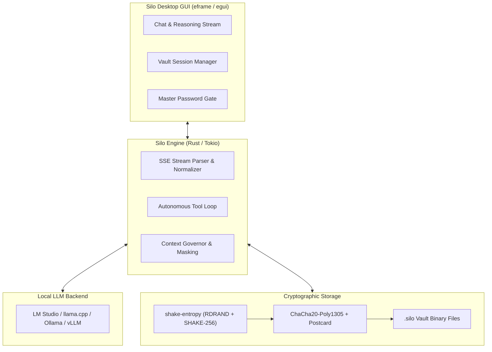

# Silo ◈

[](https://www.rust-lang.org/)
[](LICENSE)
[](https://github.com/emilk/egui)
[](https://crates.io/crates/shake-entropy)

**Silo** is a native, ultra-lightweight, privacy-first local AI engineering workbench and autonomous research agent written in Rust.

Built with **`eframe` / `egui`** and **`tokio`**, Silo runs at a locked 60 FPS with sub-millisecond input response and consumes less than 25 MB of RAM.

---

## Key Pillars

### 1. Cryptographic Vault Storage (`.silo`)
Unlike conventional clients that store full prompt histories, confidential code, and reasoning chains in plaintext JSON files on disk, Silo treats every session as a sealed vault:
* **Binary Serialization:** Sessions are encoded using [Postcard](https://crates.io/crates/postcard) for minimal footprint and zero-overhead parsing.
* **AEAD Encryption:** Encrypted on-disk via **`ChaCha20-Poly1305`** authenticated encryption with associated data.
* **Hardware Entropy via [shake-entropy](https://crates.io/crates/shake-entropy):** Key generation, salts, and 96-bit nonces are directly fed from CPU hardware intrinsics (RDRAND/RDSEED) combined with OS entropy through a SHAKE-256 cryptographic sponge.
* **Hybrid Key Architecture:** 
 * *Machine Key Mode (Default):* High-security transparent local key stored with restricted user permissions (`~/.silo/silo.key`). Instant startup with zero password prompts, yet 100% encrypted on disk.
 * *Master Passphrase Mode:* Optional Argon2id key derivation. Silo locks down on startup with a minimalist master password prompt.

### 2. Autonomous Multi-Turn Deep Research
Silo features a native, iterative deep research loop:
* **Native Web Search:** Fast, zero-dependency DuckDuckGo Lite search in pure Rust.
* **Document Distillation:** Clean HTML content extraction, stripping ads, boilerplate, and navigation menus.
* **Recursive Synthesis:** The model queries, reads source pages, tests hypotheses in Python, and formulates exhaustive technical dossiers with exact citations.

### 3. Deterministic Tool Execution
* **Python Sandbox:** Direct execution of mathematical proofs, data transformations, and algorithm checks.
* **Shell Diagnostics:** Controlled shell command execution for host environment inspection and build diagnosis.
* **Filesystem & Code Workspace:** Precise tools (`read_file`, `write_file`, `edit_file`, `search_files`) with exact line-range slicing for safe, low-context agentic code navigation.

### 4. Context & Environment Governor
Prevent LLMs from hallucinating temporal markers or inferring sensitive host metadata:
* **System Prompt Control:** Disable or override system instructions per session.
* **Temporal Anchor:** Freeze or spoof date/time exposed to the model.
* **Host Masking:** Spoof OS, architecture, current directory, or user paths to keep proprietary project structures confidential.

### 5. Multi-Host & Engine Agnostic
Silo is decoupled from any single runtime. Connect to any local or remote OpenAI-compatible host with a single click:
* **Local Engines:** Native presets for **LM Studio** (`:1234`), **llama.cpp server** (`:8080`), **Ollama** (`:11434`), and **vLLM** (`:8000`).
* **Cloud & Remote Endpoints:** Full support for custom hosts (e.g. OpenRouter, DeepSeek, Groq) with optional Bearer token authorization.
* **Dynamic Model Switching:** Automatically discovers loaded models and available checkpoints across hosts.

### 6. Native Performance
* **Pure Rust:** Zero JavaScript, zero WebKit, zero Electron.
* **Async Concurrency:** Non-blocking streaming pipeline via `tokio` mpsc channels and cancellation tokens.
* **Visuals:** Dark, modern design inspired by Linear and Raycast, featuring custom typography (Inter font stack) and syntax-highlighted code blocks with one-click copy.

---

## Architecture Overview



---

## Quickstart

### Prerequisites
* Rust 1.75+ (`rustup default stable`)
* Any OpenAI-compatible local LLM server running on `http://127.0.0.1:1234` (e.g., [LM Studio](https://lmstudio.ai/), `llama.cpp`, `vLLM`, or `Ollama`).

### Installation & Run

```bash
# Clone the repository
git clone https://github.com/herabel/silo.git
cd silo

# Run optimized release build
cargo run --release
```

### Headless CLI Diagnostics

Silo can also be used as a headless automation runner or tool tester:

```bash
# Run tool diagnostics and connectivity check
cargo run --release -- --headless --test-tools

# Autonomous deep research from the command line
cargo run --release -- --headless --deep "Explain cache-line bouncing in x86_64 SMP"

# Direct python evaluation via sandbox
cargo run --release -- --headless --eval "import math; print(math.erf(1.0))"
```

---

## Vault Storage Specification

A `.silo` session file on disk has the following binary layout:

| Offset | Length | Description |
|---|---|---|
| `0x00` | 5 bytes | Magic Header: `SILO\x01` |
| `0x05` | 12 bytes | Hardware Nonce (generated via `shake-entropy`) |
| `0x11` | Variable | Postcard-serialized `Session` ciphertext + Poly1305 MAC tag |

Plaintext data never touches disk. Even in automated mode without password prompts, moving the files to another machine without `~/.silo/silo.key` leaves them cryptographically opaque.

---

## License

Licensed under either of:
* Apache License, Version 2.0 ([LICENSE-APACHE](LICENSE-APACHE) or http://www.apache.org/licenses/LICENSE-2.0)
* MIT license ([LICENSE-MIT](LICENSE-MIT) or http://opensource.org/licenses/MIT)

at your option.